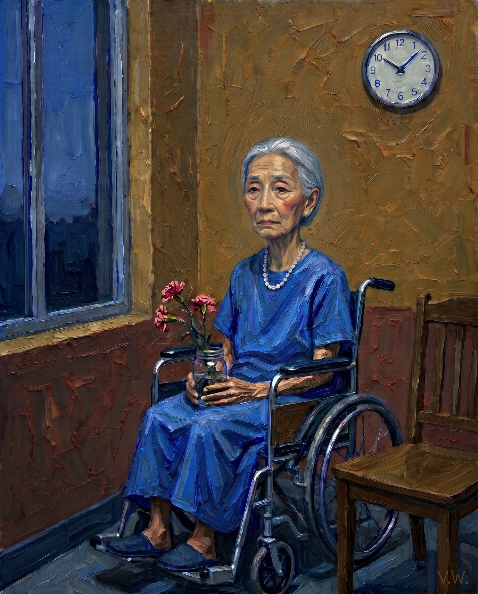
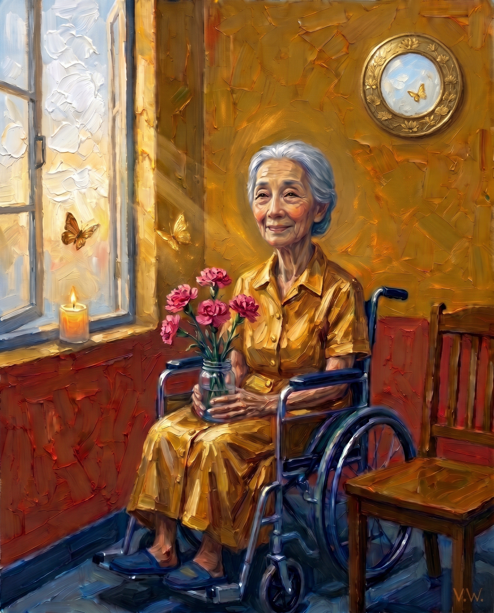
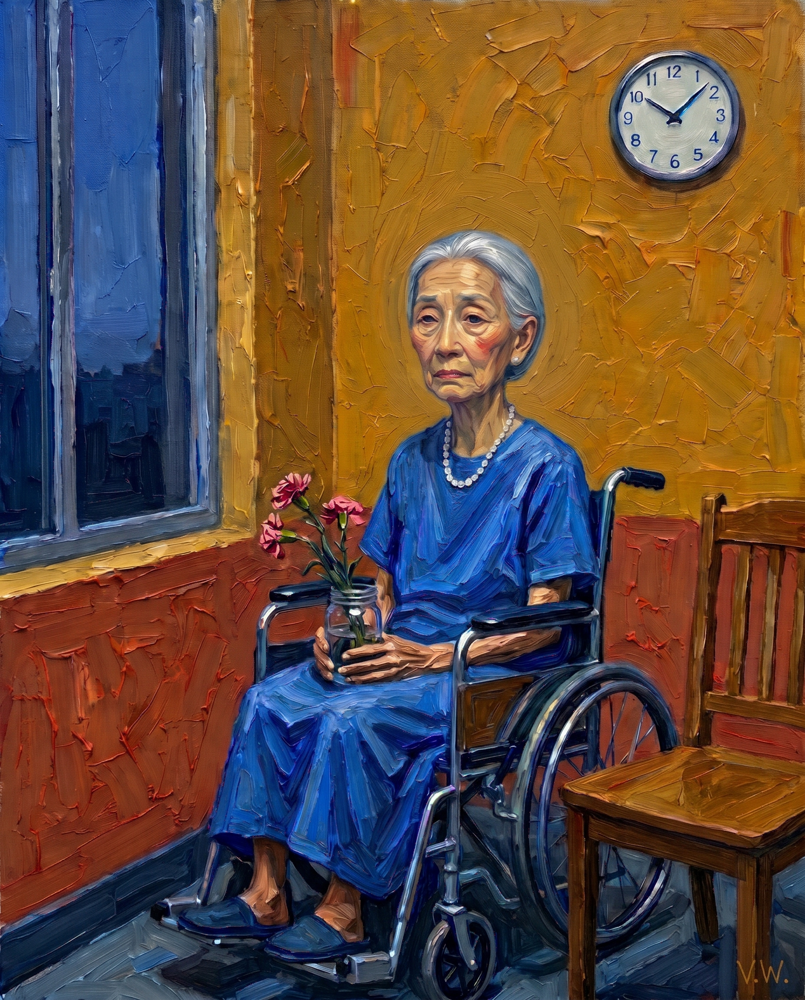
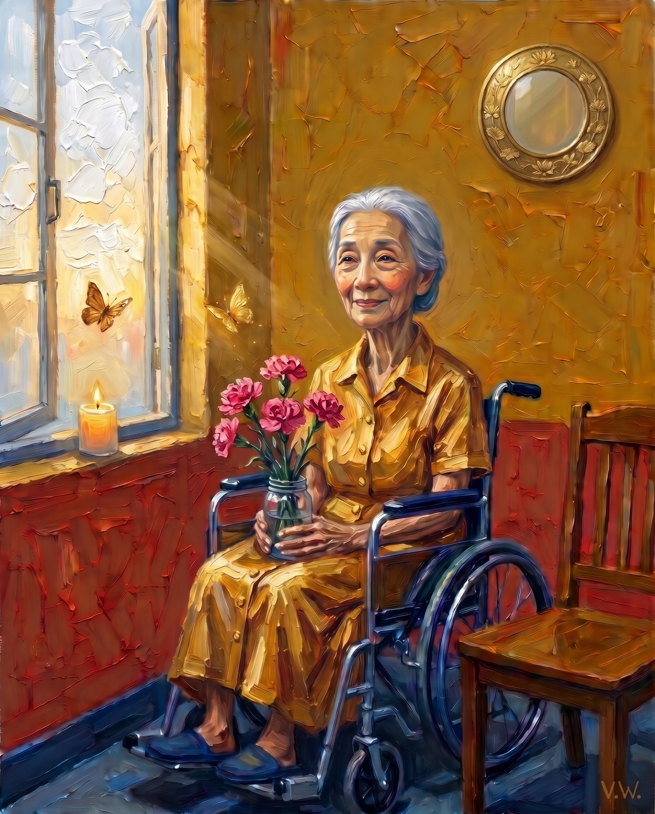

# ⚪ No Hope, Hope
## 🎯 Objective  
This project explores the end of life through two contrasting impasto acrylic paintings of an elderly Chinese woman experiencing feelings of no hope and hope. Through visual motifs with Gemini, the collection shows the quietness of dying with sorrow and peace.
## 🛠️ Tools  
Gemini 

## ⚙️ Model  
Gemini 4 Argon 

## 🖼️ Images  

<table>
  <tr>
    <td></td>
    <td></td>
  </tr>
  <tr>
    <td></td>
    <td></td>
  </tr>
